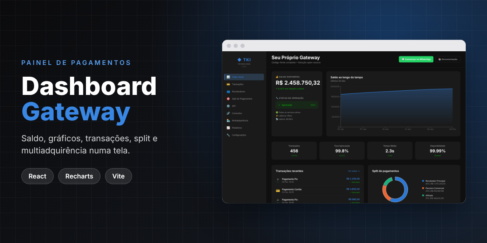
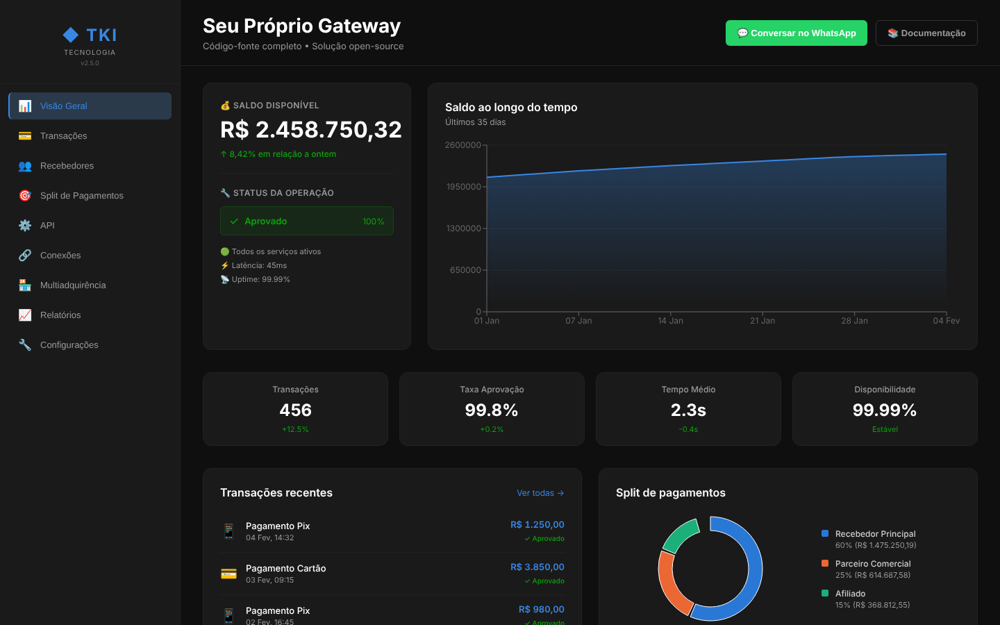
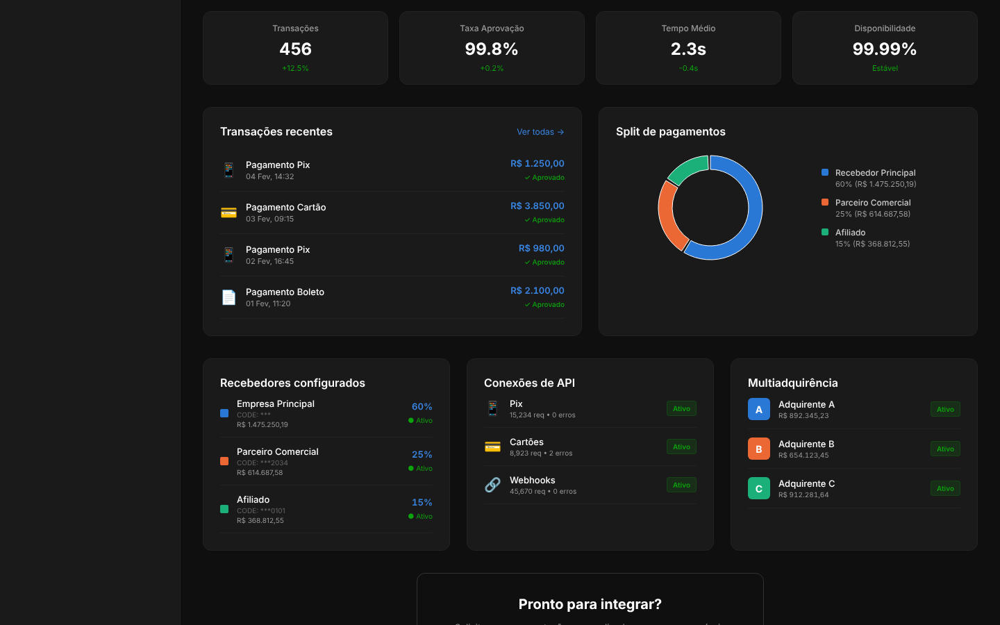
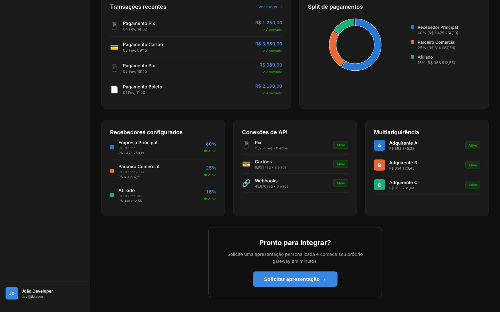

<p align="center">
  
</p>

<h1 align="center">💳 TKI Dashboard — Seu Próprio Gateway</h1>

<p align="center">
  Dashboard de um <b>gateway de pagamentos</b> feita em <b>React com Recharts</b>: saldo, gráfico de tendência,
  métricas operacionais, transações, split de pagamentos, recebedores, conexões de API e multiadquirência.
</p>

<p align="center">
  
  
  
  
</p>

<p align="center">
  <a href="#-sobre-o-projeto">Sobre</a> •
  <a href="#-funcionalidades">Funcionalidades</a> •
  <a href="#-telas">Telas</a> •
  <a href="#-como-executar">Como executar</a> •
  <a href="#-customização">Customização</a> •
  <a href="#-estrutura-do-projeto">Estrutura</a> •
  <a href="#-roadmap">Roadmap</a>
</p>

---

## 📌 Sobre o projeto

Uma dashboard completa para quem quer ter **o próprio gateway de pagamentos**, desenvolvida em **React com
Recharts** e baseada no design da TKI Tecnologia. Toda a interface está num único componente,
[`TKI_Dashboard_Completa.jsx`](TKI_Dashboard_Completa.jsx), com os estilos organizados em um objeto JavaScript.

> ⚠️ **Dados demonstrativos.** Todos os valores mostrados são simulados (definidos no início do componente),
> não contêm informações reais e servem para desenvolvimento e apresentação.

## ✨ Funcionalidades

| | Recurso | Descrição |
|---|---|---|
| 💰 | **Saldo disponível** | Valor atual, variação em relação ao dia anterior e status da operação |
| 📈 | **Saldo ao longo do tempo** | Gráfico de área (Recharts) com tooltip, cobrindo os últimos 35 dias |
| ⚡ | **Métricas operacionais** | Transações, taxa de aprovação, tempo médio e disponibilidade |
| 🧾 | **Transações recentes** | Pix, cartão e boleto; clicar numa transação mostra a taxa e o ID |
| 🎯 | **Split de pagamentos** | Gráfico de pizza com a divisão entre recebedor principal, parceiro e afiliado |
| 👥 | **Recebedores** | Percentual, valor e status de cada recebedor configurado |
| 🔗 | **Conexões de API** | Pix, cartões e webhooks com requisições e erros |
| 🏪 | **Multiadquirência** | Volume e status por adquirente |
| 🧭 | **Menu lateral** | 9 seções com ícones, indicador de página ativa e perfil do usuário |
| 📣 | **Chamada para ação** | Bloco "Pronto para integrar?" com botão de apresentação |

> As seções do menu além da **Visão Geral** ainda mostram o aviso "Seção em desenvolvimento" com um botão para
> voltar ao dashboard.

## 🖼️ Telas

<table>
  <tr>
    <td align="center"><b>Visão geral</b><br></td>
    <td align="center"><b>Transações e split</b><br></td>
  </tr>
  <tr>
    <td align="center" colspan="2"><b>Recebedores, API e multiadquirência</b><br></td>
  </tr>
</table>

## 🚀 Como executar

**Pré-requisito:** Node.js 14.18+ / 16+ (exigido pelo Vite 4).

```bash
git clone https://github.com/kauaxp77/Dashboard_gateway.git
cd Dashboard_gateway
npm install
npm run dev
```

Para gerar a versão de produção (pasta `dist/`) e conferir o resultado:

```bash
npm run build
npm run preview
```

> O `index.html` é a página de entrada do Vite: ele carrega `src/main.jsx` e precisa do `npm run dev` (ou do
> build) para funcionar. Abrir o arquivo direto no navegador não mostra a dashboard.

### Importar o componente em um projeto existente

```jsx
import TKIDashboard from './TKI_Dashboard_Completa.jsx';

function App() {
  return <TKIDashboard />;
}

export default App;
```

O projeto que importar o componente precisa ter `react`, `react-dom` e `recharts` instalados.

## 🎨 Customização

### Alterar cores

Edite os valores das cores principais no arquivo JSX:

```javascript
// Cores principais
#3987e5  // Azul principal
#2a78d6  // Azul escuro
#0ca30c  // Verde (sucesso)
#eb6834  // Laranja
#1baf7a  // Teal
```

### Adicionar dados reais

Substitua os dados simulados por chamadas a uma API:

```javascript
// Antes (dados simulados)
const recentTransactions = [
  { id: 1, name: 'Pagamento Pix', value: 1250.00, ... }
];

// Depois (API real)
const [transactions, setTransactions] = useState([]);

useEffect(() => {
  fetch('/api/transactions')
    .then(res => res.json())
    .then(data => setTransactions(data));
}, []);
```

### Adicionar novas seções

1. Adicione um novo item ao `menuItems`:

```javascript
{ id: 'novasecao', label: 'Minha Seção', icon: '🎯' }
```

2. Adicione o conteúdo no renderizador:

```javascript
{activePage === 'novasecao' && (
  <div>
    {/* seu conteúdo aqui */}
  </div>
)}
```

### Componentes reutilizáveis

- `MetricCard`: cards de métrica
- `TransactionCard`: cards de transação (com detalhes ao clicar)
- Gráficos Recharts customizados (`AreaChart` e `PieChart`)

## 🔐 Segurança

Para levar a dashboard para produção com dados reais:

- implemente autenticação;
- valide os dados no backend;
- use HTTPS sempre;
- sanitize a entrada do usuário.

## 📁 Estrutura do projeto

```
Dashboard_gateway/
├── TKI_Dashboard_Completa.jsx   # Componente React completo (dados simulados, layout e estilos)
├── src/
│   └── main.jsx                 # Monta o componente na página
├── index.html                   # Página de entrada do Vite
├── docs/                        # Banner e capturas de tela deste README
├── package.json                 # Dependências e scripts
└── package-lock.json
```

## 🎯 Roadmap

- [ ] Implementar as seções do menu além da Visão Geral
- [ ] Layout para celular (hoje o menu lateral tem largura fixa e a dashboard é pensada para desktop)
- [ ] Integração com APIs reais
- [ ] Dark mode toggle
- [ ] Exportação de relatórios (PDF/Excel)
- [ ] Notificações em tempo real
- [ ] Filtros avançados
- [ ] Modo offline com localStorage
- [ ] Tema customizável
- [ ] PWA (Progressive Web App)

## 🛠️ Tecnologias

- **React 18**: interface em um único componente
- **Recharts**: gráficos de área e de pizza
- **Vite 4**: servidor de desenvolvimento e build
- **Intl.NumberFormat**: valores formatados em reais (pt-BR)

## 👨‍💻 Autor

Desenvolvido por **[kauaxp77](https://github.com/kauaxp77)**

<p align="center">⭐ Se curtiu o projeto, deixe uma estrela!</p>
